# How data flows into QE Navigator and is processed

This page explains how data gets into QE Navigator and what happens to it. It shows where each step happens in
the code, and how every indicator on the screens is calculated. Each code excerpt below is copied from the files
as they are at commit `3e63248` (the version live on app.irongate.ie), with the file path and line numbers.
Wherever the code does not settle a question, this page says "unclear". Sections 3.3, 3.4, 4.3, 4.4, 4.8, 4.11 and 7
describe the changes that closed the gaps listed in section 7 (they name functions rather than line numbers).

The example requests are in [docs/examples/ingest/](examples/ingest/). The test
`tests/api/ingest-examples.test.ts` sends every one of them to a local API, as a dry run and then for real. It
checks that they are accepted, that every field was stored, and that every indicator listed below gets a value.

---

## 1. Overview

```mermaid
flowchart LR
  subgraph Customer["Customer network"]
    T["Tools: CI (GitHub Actions, GitLab, Jenkins, Azure DevOps),<br/>Jira / Linear, PagerDuty / Opsgenie, SonarQube"]
    X["QE Navigator Exporter<br/>(reads the tools, calculates nothing)"]
    T --> X
  end
  X -- "HTTPS, JSON envelope<br/>Authorization: Bearer igk_…" --> B["POST /api/ingest/exporter/batch"]
  subgraph QEN["QE Navigator"]
    B --> C1["1. API key check<br/>(apiKey.ts)"]
    C1 --> C2["2. Envelope shape check, then<br/>company, department, team check"]
    C2 --> H["3. Handler per kind<br/>(dry run of every item first)"]
    H --> P["4. Parser<br/>(packages/engine/src/parsers)"]
    P --> R["5. Raw tables<br/>(raw_uploads, test_runs, issues, …)"]
    R --> Q["6. calc_queue entry<br/>(days to recalculate)"]
    Q --> D["7. Background drain"]
    D --> E["8. Engine<br/>(packages/engine/src/calc)"]
    E --> V["9. metric_values → kpi_snapshots<br/>(QA score by database trigger)"]
    E --> EV["metric_evidence<br/>(How this was calculated)"]
    V --> UI["Dashboards, forecasts, recommendations,<br/>alerts, Business impact"]
    EV --> UI
  end
```



In plain words:

1. The **QE Navigator Exporter** runs inside the customer's network. It reads their tools and sends the **raw**
   data: test report files, coverage files, SARIF, pipeline runs, deployments, commits, incidents and issues. It
   calculates nothing (`server/lib/exporterIngest.ts` lines 5–7).
2. Each request is one **JSON envelope**:
   `{ companyId, departmentId, teamId, source, kind, items }`. It goes over HTTPS with the company's API key.
3. QE Navigator checks the key, then checks that the company, department and team belong to that key.
4. Each kind goes to its own **handler**. The handler runs the **parser** for that format and writes the
   parsed records to the **raw tables**.
5. The handler does not calculate during the request. It records the affected days in the **calculation queue**
   (`calc_queue`). A **background drain** then recalculates those days with the **engine**. (On a long-running
   server without `INGEST_CALC=queued`, the calculation runs inside the request instead. The result is the same.)
6. The engine writes three things:
   - each value with its formula, inputs and source records to `metric_evidence` (the "How this was calculated"
     panel);
   - the values that have a KPI column to `metric_values`;
   - the daily `kpi_snapshots`, which are rebuilt from `metric_values`. A database trigger computes the QA score.
7. Dashboards, forecasts, recommendations, alerts and Business impact read those tables.

### The other ways in (all reach the same handlers or the same KPI write path)

| Entry point | What it is | Where |
|---|---|---|
| Direct endpoints `POST /api/ingest/tests`, `/coverage`, `/pipelines`, `/deployments`, `/commits`, `/incidents`, `/issues`, `/static-analysis` | The same handlers the envelope uses. Your CI calls them directly, with the team as a query parameter. | `server/routes/ingestRaw.ts` 375–377, `ingestDelivery.ts` 250–252, `ingestWork.ts` 311–312 |
| `POST /api/ingest/kpis` | Values you calculated yourself (the 23 KPI columns), one item or up to 100 | `server/routes/ingest.ts` 52–221 |
| File upload (Admin console → Upload files) | Someone drops exported files on the page. Each file becomes requests to the same handlers (`channel: upload`). | `server/lib/ingest/upload.ts` 1–15, `server/routes/uploads.ts` 228 / 278 |
| Manual entry (Manual metrics page) | A person types KPI values. They go through the same `recordKpiValues` path with `source: manual`. | `server/routes/metrics.ts` 288 |
| Typed in by people, not machine-ingested | Wellbeing pulse answers (`server/routes/pulse.ts` 125), the business side of the Business impact monthly figures (and corrections of the quality side, recorded as `manual`: section 3.4), Financial and ROI settings (Parameters, read by `server/lib/financialConfig.ts`), technical debt items added or edited on the Technical debt page (beside the items derived from static analysis), developer metrics (`server/routes/metrics.ts`) | see each file |

---

## 2. Step by step, with the code

### 2.1 The API key is checked

The key arrives as `Authorization: Bearer igk_…`. Only its SHA-256 hash is stored. The middleware looks up the
hash and refuses:

- a key that is unknown or revoked (401);
- a suspended company (403);
- the demo sandbox (403).

`server/middleware/apiKey.ts` lines 25–53:

```ts
/** Authenticate `Authorization: Bearer igk_…`. 401 for a missing, unknown or revoked key. */
export async function authenticateApiKey(req: ApiKeyRequest, res: Response, next: NextFunction) {
  try {
    const header = req.headers['authorization'];
    const token = typeof header === 'string' && header.startsWith('Bearer ') ? header.slice(7).trim() : '';
    if (!token.startsWith(API_KEY_PREFIX)) {
      return res.status(401).json({ error: 'API key required (Authorization: Bearer igk_…)' });
    }
    const row = await queryOne<any>(
      `SELECT k.id, k.company_id, k.name, c.status AS company_status
         FROM api_keys k JOIN companies c ON c.id = k.company_id WHERE k.key_hash = ? AND k.revoked_at IS NULL`,
      [hashApiKey(token)]
    );
    if (!row) return res.status(401).json({ error: 'Invalid or revoked API key' });
    // A suspended organisation (companies.status): its keys are refused until it is reactivated.
    if (row.company_status === 'suspended') {
      return res.status(403).json({ error: "Your organisation's access is suspended. Contact your administrator.", code: 'company_suspended' });
    }
    // The demo sandbox (server/lib/sandboxConfig.ts) takes no data from outside: its keys are refused.
    if (isSandboxCompany(row.company_id)) return res.status(403).json({ error: 'The demo sandbox does not accept data.', code: 'sandbox_read_only' });
    req.apiKey = { id: row.id, companyId: row.company_id, name: row.name };
    // Best effort; never blocks the request.
    query('UPDATE api_keys SET last_used_at = now() WHERE id = ?', [row.id]).catch(() => undefined);
    next();
  } catch (error) {
    console.error('API key auth error:', error);
    res.status(500).json({ error: 'Authentication failed' });
  }
}
```

For the envelope, `batchAuth` (`server/routes/ingestExporter.ts` lines 103–123) wraps this check, so that a
refused key is also written to the operator log (with the key's prefix only).

### 2.2 The envelope, then the company, department and team

`parseEnvelope` checks the shape. It accepts only the six envelope fields, the id format, the source name, the
kind and the number of items.

`server/lib/exporterIngest.ts` lines 44–63:

```ts
/** Shape check of the envelope (not the ids against the key: the route does that). Missing ids: 400. */
export function parseEnvelope(body: unknown): Envelope {
  if (!isObj(body)) throw new EnvelopeError(400, 'The body must be a JSON object: { companyId, departmentId, teamId, source, kind, items }');
  const extra = Object.keys(body).filter((k) => !ENVELOPE_FIELDS.includes(k));
  if (extra.length) throw new EnvelopeError(400, `Unexpected field(s): ${extra.slice(0, 5).join(', ')} (allowed: ${ENVELOPE_FIELDS.join(', ')})`);
  for (const f of ['companyId', 'departmentId', 'teamId'] as const) {
    const v = body[f];
    if (v === undefined || v === null || v === '') throw new EnvelopeError(400, `${f} is required (the ids are on Admin console → Connect your CI, and GET /api/ingest/exporter/context)`);
    if (typeof v !== 'string' || !ID.test(v)) throw new EnvelopeError(400, `${f} must be an id (letters, digits, "_", "-", ".", ":"; at most 36 characters)`);
  }
  if (typeof body.source !== 'string' || !SOURCE.test(body.source)) throw new EnvelopeError(400, 'source is required: the name of the Exporter source (lowercase letters, digits, "-" or "_", at most 50)');
  if (typeof body.kind !== 'string' || !(EXPORTER_KINDS as readonly string[]).includes(body.kind)) {
    throw new EnvelopeError(400, `kind must be one of ${EXPORTER_KINDS.join(', ')}`);
  }
  const kind = body.kind as ExporterKind;
  if (!Array.isArray(body.items) || body.items.length === 0 || body.items.length > MAX_ITEMS[kind]) {
    throw new EnvelopeError(400, `items must list 1 to ${MAX_ITEMS[kind]} ${kind} items`);
  }
  return { companyId: body.companyId as string, departmentId: body.departmentId as string, teamId: body.teamId as string, source: body.source, kind, items: body.items };
}
```

`checkIds` then checks the ids against the key:

- `companyId` must be the key's company;
- `departmentId` must be a department of that company;
- `teamId` must be an active team of that department.

The answer is the same 403 whether the id belongs to another company or does not exist.

`server/routes/ingestExporter.ts` lines 88–95:

```ts
/** companyId = the key's company; the department in it; the team active, in that department and company. */
async function checkIds(companyId: string, env: Envelope): Promise<void> {
  if (env.companyId !== companyId) throw new EnvelopeError(403, NOT_YOURS.company);
  const dep = await queryOne<any>('SELECT 1 AS ok FROM departments WHERE id = ? AND company_id = ?', [env.departmentId, companyId]);
  if (!dep) throw new EnvelopeError(403, NOT_YOURS.department);
  const team = await queryOne<any>('SELECT 1 AS ok FROM teams WHERE id = ? AND company_id = ? AND department_id = ? AND is_active IS NOT FALSE', [env.teamId, companyId, env.departmentId]);
  if (!team) throw new EnvelopeError(403, NOT_YOURS.team);
}
```

### 2.3 Each kind is sent to its handler

Each envelope kind maps to an existing ingestion handler. There is no second copy of the parsing or storage.

`server/lib/exporterIngest.ts` lines 20–27:

```ts
/** The envelope kinds and the ingestion handler each one goes through. */
export const EXPORTER_KINDS = ['test-report', 'coverage', 'pipeline-runs', 'deployments', 'commits', 'incidents', 'issues', 'sarif', 'kpis'] as const;
export type ExporterKind = (typeof EXPORTER_KINDS)[number];
export type HandlerKind = 'tests' | 'coverage' | 'pipelines' | 'deployments' | 'commits' | 'incidents' | 'issues' | 'static-analysis' | 'kpis';
export const HANDLER_OF: Record<ExporterKind, HandlerKind> = {
  'test-report': 'tests', coverage: 'coverage', 'pipeline-runs': 'pipelines', deployments: 'deployments', commits: 'commits',
  incidents: 'incidents', issues: 'issues', sarif: 'static-analysis', kpis: 'kpis',
};
```

`server/routes/ingestExporter.ts` lines 46–57:

```ts
const HANDLERS: Record<HandlerKind, IngestHandler> = {
  tests: rawIngestHandler('tests'),
  coverage: rawIngestHandler('coverage'),
  pipelines: rawIngestHandler('pipelines'),
  deployments: deliveryIngestHandler('deployments'),
  commits: deliveryIngestHandler('commits'),
  incidents: deliveryIngestHandler('incidents'),
  issues: handleIssues,
  'static-analysis': handleStaticAnalysis,
  // Called lazily: server/routes/ingest.ts mounts this router, so its exports are read at request time.
  kpis: (req, res) => handleKpis(req, res),
};
```

`submissionsOf` (`server/lib/exporterIngest.ts` 92–144) turns the items into handler requests:

- report kinds become one multipart request per item;
- event kinds become one JSON list;
- the kpis kind becomes one array of KPI items.

The envelope's team is always the team written to. Every part is first checked as a dry run. Only when every
part passes are the parts written, each in its own transaction:

`server/routes/ingestExporter.ts` lines 188–211:

```ts
    // 1. Every part checked by its handler first (a dry run that writes nothing, not even a log row).
    const checks: Array<{ index: number | null; result: any }> = [];
    for (const [i, s] of subs.entries()) {
      // A re-sent batch: its parts are answered from the log, so they are not checked again.
      if (key && !dryRun && (await findReplay(caller, partKey(key, i)))) { checks.push({ index: s.index, result: null }); continue; }
      const r = await invokeHandler(HANDLERS[s.handler], { caller: { ...caller, preview: true }, body: s.body, contentType: s.contentType, query: { ...s.query, dryRun: 'true' } });
      if (r.status >= 400) {
        const { status: _s, ingestionId: _i, ...detail } = r.body ?? {};
        return await reject(r.status, `${itemLabel(s)}: ${r.body?.error ?? 'refused'}`, { ...ids, item: s.index, detail });
      }
      checks.push({ index: s.index, result: r.body });
    }
    if (dryRun) {
      await delivery('accepted', 200, { reasonCode: 'dry_run' });
      return res.status(200).json({ status: 'dry-run', ...ids, items: checks, message: 'Key, ids and items are valid. Nothing was stored.' });
    }

    // 2. Written part by part through the same handlers (each in its own transaction with its log row, channel Exporter).
    const items: Array<{ index: number | null; status: 'written' | 'duplicate' | 'rejected'; httpStatus: number; replayed: boolean; result: any }> = [];
    for (const [i, s] of subs.entries()) {
      const r = await invokeHandler(HANDLERS[s.handler], { caller, body: s.body, contentType: s.contentType, query: s.query, idempotencyKey: key ? partKey(key, i) : null });
      const st = r.status >= 400 ? 'rejected' : r.body?.status === 'duplicate' || r.body?.status === 'ignored' ? 'duplicate' : 'written';
      items.push({ index: s.index, status: st, httpStatus: r.status, replayed: r.replayed, result: r.body });
    }
```

### 2.4 A parser, for example JUnit XML

The JUnit parser reads `<testsuite>` and `<testcase>`. A `<failure>` or `<error>` sets the status. `<skipped>`
marks the test skipped. Surefire's `<flakyFailure>` and `<rerunFailure>` count as retries inside the run.

`packages/engine/src/parsers/testReports.ts` lines 100–126:

```ts
      } else if (name === 'testcase') {
        if (cases.length >= MAX_TEST_CASES) throw new ReportError(`More than ${MAX_TEST_CASES} test cases in one report`);
        const suiteName = suiteStack[suiteStack.length - 1]?.name || a.file || '';
        const name = a.name ?? '(unnamed)';
        let cls = a.classname || a.class || '';
        // Jest (classname = the title) and mocha / Cypress (classname = the end of the title) put the test
        // title in classname: the enclosing suite (the file or describe block) is the better suite then.
        if (cls && suiteName && (cls === name || (name.endsWith(cls) && name !== cls))) cls = '';
        const suite = cls || suiteName;
        const st = (a.status ?? '').toLowerCase();
        current = {
          suite: suite.slice(0, 500), name: name.slice(0, 1000),
          status: st === 'skipped' || st === 'disabled' || st === 'notrun' ? 'skipped' : 'passed',
          durationMs: Math.round(parseSeconds(a.time) * 1000), retries: 0, message: null,
        };
      } else if (current) {
        if (name === 'failure' || name === 'error') {
          current.status = name === 'failure' ? 'failed' : 'error';
          current.message = clip(a.message) ?? current.message;
          if (!current.message) { collecting = true; textBuf = ''; }
        } else if (name === 'skipped') {
          if (current.status === 'passed') current.status = 'skipped';
        } else if (name === 'flakyFailure' || name === 'flakyError' || name === 'rerunFailure' || name === 'rerunError') {
          current.retries++;
          if (!current.message) current.message = clip(a.message);
        }
      }
```

The other parsers sit next to it in `packages/engine/src/parsers/`:

- `testReports.ts`: TRX and Cucumber;
- `coverageReports.ts`: lcov, Cobertura, JaCoCo, Istanbul, a unified diff and a changed-lines list;
- `sarif.ts`;
- `pipelineEvents.ts`;
- `deliveryEvents.ts`: deployments, commits and incidents;
- `issueEvents.ts`: Jira, Linear and QE Navigator JSON.

`server/lib/ingest/*.ts` re-exports them.

### 2.5 The raw rows are written

Every request first gets a `raw_uploads` row: a gzipped copy of the payload, kept for 13 months, and
idempotent per team, kind, commit, run and attempt. A test report then becomes one `test_runs` row and one
`test_results` row per test case:

`server/lib/ingest/store.ts` lines 62–89:

```ts
export async function storeTestRun(client: pg.PoolClient, m: UploadMeta, uploadId: string, rep: ParsedTestReport, at: Date, opts: { id?: string; sample?: boolean } = {}): Promise<{ runId: string; day: string }> {
  const id = opts.id;
  const r = await client.query(
    `INSERT INTO test_runs (${id ? 'id, ' : ''}company_id, team_id, upload_id, format, commit_sha, branch, run_id, attempt, started_at, day,
                            total, passed, failed, errored, skipped, duration_ms, tests_duration_ms, is_sample)
     VALUES (${id ? '$18, ' : ''}$1, $2, $3, $4, $5, $6, $7, $8, $9::timestamptz, $10::date, $11, $12, $13, $14, $15, $16, $17, ${id ? '$19' : '$18'}) RETURNING id`,
    [m.companyId, m.teamId, uploadId, rep.format, m.commit, m.branch, m.runId, m.attempt, at.toISOString(), dayOf(at),
      rep.counts.total, rep.counts.passed, rep.counts.failed, rep.counts.errored, rep.counts.skipped, rep.durationMs, rep.testsDurationMs,
      ...(id ? [id] : []), !!opts.sample]
  );
  const runId: string = r.rows[0].id;
  await insertTestResults(client, runId, m.teamId, rep);
  return { runId, day: dayOf(at) };
}

export async function insertTestResults(client: pg.PoolClient, runId: string, teamId: string, rep: ParsedTestReport): Promise<void> {
  const CHUNK = 5000;
  for (let i = 0; i < rep.cases.length; i += CHUNK) {
    const part = rep.cases.slice(i, i + CHUNK);
    await client.query(
      `INSERT INTO test_results (test_run_id, team_id, test_key, suite, name, status, duration_ms, retries, failure_hash, failure_message)
       SELECT $1, $2, x.k, x.s, x.n, x.st, x.d, x.r, x.fh, x.fm
         FROM unnest($3::text[], $4::text[], $5::text[], $6::text[], $7::int[], $8::int[], $9::text[], $10::text[]) AS x(k, s, n, st, d, r, fh, fm)`,
      [runId, teamId, part.map((c) => testKey(c.suite, c.name)), part.map((c) => c.suite), part.map((c) => c.name), part.map((c) => c.status),
        part.map((c) => Math.min(c.durationMs, 2_000_000_000)), part.map((c) => c.retries), part.map((c) => failureHash(c.message)), part.map((c) => c.message)]
    );
  }
}
```

The other raw writers:

| Kind | Writer | Tables |
|---|---|---|
| coverage | `storeCoverage` in `server/lib/ingest/store.ts` (91–114) | `coverage_reports`, `coverage_files` |
| pipelines | `storePipelineRuns` in `server/lib/ingest/store.ts` (122–167) | `pipeline_runs_raw`, `pipeline_stage_runs` |
| deployments, commits, incidents | `server/lib/ingest/deliveryStore.ts` | `deployments_raw`, `deployment_commits`, `incidents_raw`, `incident_updates` |
| issues | `storeSprints` and `storeIssues` in `server/lib/ingest/workStore.ts` | `issue_sprints`, `issues`, `issue_transitions` |
| SARIF | `storeAnalysis` in `server/lib/ingest/workStore.ts` | `analysis_reports`, `analysis_findings` |

### 2.6 The calculation queue entry is created

`calcOrQueue` runs in the same transaction as the raw rows. In queued mode it records the affected days (team,
first day, last day, metric groups) in `calc_queue`. Otherwise it recalculates them at once.

`server/lib/calc/queue.ts` lines 136–149:

```ts
/**
 * The ingestion handlers' calculation step: recalculated now (inline mode, the old behaviour) or queued (the answer
 * then says calculation "queued" and the caller starts the drain after its commit: kickCalc).
 */
export async function calcOrQueue(
  client: pg.PoolClient, companyId: string, teamId: string, days: string[], opts: RecomputeOptions & { groups: MetricGroup[] },
): Promise<{ days: DayResult[]; queued: boolean }> {
  if (!days.length) return { days: [], queued: false };
  if (calcDeferred() && (await calcQueueReady(client))) {
    await enqueueCalc(client, { companyId, teamId, days, kinds: opts.groups, ingestionId: opts.ingestionId ?? null, actorId: opts.actorId ?? null });
    return { days: [], queued: true };
  }
  return { days: await recomputeTeamDays(client, teamId, days, opts), queued: false };
}
```

Queued mode is the default on Netlify, and is turned on elsewhere with `INGEST_CALC=queued`
(`calcDeferred`, `server/lib/calc/queue.ts` 58–64). The affected days depend on the kind:

- tests: the day and the 6 days after it (the flaky-test window);
- delivery: the day and the 27 days after it;
- work: the day and the 41 days after it, at most 190 days back;
- quality: the day and the 30 days after it.

### 2.7 The background drain

After the commit, `triggerCalcDrain` starts a drain:

- on Netlify, the background function `calc-drain-background`;
- elsewhere, the same process, after the answer has been sent.

The drain claims one entry at a time (`FOR UPDATE SKIP LOCKED`) and recalculates its days with the engine. It
marks the entry done in the same transaction. A failed entry is retried up to 5 times.

`server/lib/calc/queue.ts` lines 402–419:

```ts
      const days = daysOf(e.from_day, e.to_day);
      try {
        const result = await withTransaction(async (client) => {
          const r = await recompute(client, e.team_id, days, { groups: e.kinds, ingestionId: e.ingestion_id, actorId: e.actor_id });
          await client.query(`UPDATE calc_queue SET status = 'done', finished_at = now(), updated_at = now(), last_error = NULL WHERE id = $1`, [e.id]);
          return r;
        });
        out.processed++;
        out.days += days.length;
        const cols = result.flatMap((d) => d.metrics.filter((m) => m.written && m.kpi).map((m) => m.kpi as string));
        out.values += cols.length;
        if (cols.length) {
          const byTeam = written.get(e.company_id) ?? new Map<string, Set<string>>();
          const set = byTeam.get(e.team_id) ?? new Set<string>();
          for (const c of cols) set.add(c);
          byTeam.set(e.team_id, set);
          written.set(e.company_id, byTeam);
        }
```

Safety net: the hourly alerts-evaluate job and the twice-daily db-keepalive job also start a drain when entries
are waiting. The nightly `recomputeRecent` (`server/lib/calc/engine.ts` 225–254) recalculates the last 8 days of
every team that has raw data.

### 2.8 The engine computes a metric

`recomputeTeamDays` reads the raw records of each day and runs the shared engine (`packages/engine/src/calc`).
It does this per metric group: `ci`, `delivery`, `work` and `quality`.

`server/lib/calc/engine.ts` lines 138–143:

```ts
  const perDay = new Map<string, ComputedMetric[]>();
  for (const day of list) {
    const computed = [...(groups.includes('ci') ? await computeTeamDay(client, teamId, day) : []), ...(delivery.get(day) ?? []), ...(work.get(day) ?? []), ...(quality.get(day) ?? [])];
    // One value per metric and day (a later one replaces an earlier one, as consecutive upserts did).
    perDay.set(day, Array.from(new Map(computed.map((m) => [m.key, m])).values()));
  }
```

Here is one rule from the engine: pipeline success rate and build time.

`packages/engine/src/calc/ci.ts` lines 203–215:

```ts
  // --- Pipelines ---------------------------------------------------------------------------
  const pipes = data.pipelines.filter((p) => p.day === day).sort((a, b) => a.startedAt - b.startedAt).map((p) => ({ ...p, at: p.finishedAt ?? p.startedAt }));
  const done = pipes.filter((p) => p.result !== 'cancelled');
  if (done.length) {
    const lastAt = iso(done.reduce((m, p) => (p.at > m ? p.at : m), done[0].at));
    const ok = done.filter((p) => p.result === 'success').length;
    out.push({ key: 'pipeline_success_rate', value: r2((ok / done.length) * 100), inputs: { successful: ok, failed: done.length - ok, cancelled: pipes.length - done.length }, sources: { pipelineRuns: done.slice(-50).map((p) => p.id) }, sampleSize: done.length, recordedAt: lastAt });
    const ds = done.map((p) => p.durationS).filter((d) => d !== null && d !== undefined).map(Number);
    if (ds.length) {
      const med = median(ds)!;
      out.push({ key: 'build_time', value: r2(med / 60), inputs: { medianSeconds: med, runs: ds.length, minSeconds: Math.min(...ds), maxSeconds: Math.max(...ds) }, sources: { pipelineRuns: done.slice(-50).map((p) => p.id) }, sampleSize: ds.length, recordedAt: lastAt });
    }
  }
```

### 2.9 KPI values and snapshots are written

A value that has a KPI column, and that changed since the last calculation, is clamped to the column's range.
It is then written through the one KPI write path, `recordKpiValues`, with `source: 'computed'`:

`server/lib/calc/engine.ts` lines 174–192:

```ts
    for (const m of computed) {
      const spec = METRICS[m.key];
      const conf = confidenceFor(m.sampleSize);
      const old = prevAll.get(`${day}|${m.key}`);
      const changed = !old || Number(old.value) !== m.value || iso(old.recorded_at) !== m.recordedAt;
      const write = opts.writeKpis !== false && !!spec.kpi && changed && !sampleOnly.has(groupOf(m.key));
      if (write) {
        // The evidence keeps the exact value; the KPI column holds what its type can (e.g. lead time ≤ 99.99 days).
        const range = KPI_COLUMNS[spec.kpi as KpiColumn];
        kpiValues[spec.kpi as string] = Math.min(range.max, Math.max(range.min, m.value));
        if (m.recordedAt > recordedAt) recordedAt = m.recordedAt;
      }
      dayOut.metrics.push({ key: m.key, value: m.value, sampleSize: m.sampleSize, confidence: conf, kpi: spec.kpi, written: write });
    }
    if (Object.keys(kpiValues).length) {
      // Never later than now (a KPI value is for a moment that has happened).
      const at = new Date(Math.min(new Date(recordedAt).getTime(), Date.now()));
      await recordKpiValues(teamId, kpiValues, { source: 'computed', recordedAt: at, client, notify: false, actorId: opts.actorId ?? null, ingestionId: opts.ingestionId ?? null, companyId: team.company_id });
    }
```

`writeMetricValues` is the only writer of `metric_values`. It then rebuilds the team's `kpi_snapshots` from that
day onwards:

`server/lib/metricValues.ts` lines 44–69:

```ts
export async function writeMetricValues(client: pg.PoolClient, input: MetricValueInput): Promise<{ day: string; valueIds: string[] }> {
  const metrics = Object.keys(input.values);
  const valueIds = metrics.map(() => randomUUID());
  // One INSERT for every value, then one UPDATE: a second value for the same moment is a correction of the first.
  // Values are sent as text, as a single-row insert sends them, so the stored numbers are identical.
  await q(
    client,
    `INSERT INTO metric_values (id, company_id, team_id, metric_key, value, recorded_at, source, source_ref, idempotency_key, actor_id, ingestion_id)
     SELECT x.id, ?, ?, x.metric, x.value::numeric, ?::timestamptz, ?, ?, ?, ?, ?
       FROM unnest(?::text[], ?::text[], ?::text[]) WITH ORDINALITY AS x(id, metric, value, o)
      ORDER BY x.o`,
    [input.companyId, input.teamId, input.recordedAt, input.source, input.sourceRef ?? null, input.idempotencyKey ?? null, input.actorId, input.ingestionId ?? null,
      valueIds, metrics, metrics.map((m) => (input.values[m] === null || input.values[m] === undefined ? null : String(input.values[m])))]
  );
  await q(
    client,
    `UPDATE metric_values mv SET superseded_by = x.id
       FROM unnest(?::text[], ?::text[]) AS x(id, metric)
      WHERE mv.team_id = ? AND mv.metric_key = x.metric AND mv.recorded_at = ?::timestamptz AND mv.superseded_by IS NULL AND mv.id <> x.id`,
    [valueIds, metrics, input.teamId, input.recordedAt]
  );
  // The UTC day of recordedAt, as (recordedAt AT TIME ZONE 'UTC')::date.
  const day = new Date(input.recordedAt).toISOString().slice(0, 10);
  await q(client, 'SELECT public.refresh_kpi_snapshots(?, ?::date, ?::text[])', [input.teamId, day, metrics]);
  return { day, valueIds };
}
```

### 2.10 "How this was calculated" evidence

Every computed value is upserted into `metric_evidence` with:

- its formula;
- its inputs (counts, medians, windows);
- its source records (run ids, flaky tests, failed deploys, escaped issue keys and so on);
- the sample size and a confidence level.

`server/lib/calc/engine.ts` lines 148–163:

```ts
  const evidence = list.flatMap((day) => perDay.get(day)!.map((m) => {
    const spec = METRICS[m.key];
    return { day, key: m.key, value: m.value, unit: spec.unit, formula: spec.formula, inputs: m.inputs, sources: m.sources, n: m.sampleSize, conf: confidenceFor(m.sampleSize), kpi: spec.kpi, at: m.recordedAt };
  }));
  const CHUNK = 500;
  for (let i = 0; i < evidence.length; i += CHUNK) {
    await client.query(
      `INSERT INTO metric_evidence (company_id, team_id, day, metric_key, value, unit, formula, inputs, sources, sample_size, confidence, kpi_column, recorded_at, computed_at)
       SELECT $1, $2, x.day, x.key, x.value, x.unit, x.formula, COALESCE(x.inputs, '{}'::jsonb), COALESCE(x.sources, '{}'::jsonb), x.n, x.conf, x.kpi, x.at, now()
         FROM jsonb_to_recordset($3::jsonb) AS x(day date, key text, value numeric, unit text, formula text, inputs jsonb, sources jsonb, n int, conf text, kpi text, at timestamptz)
       ON CONFLICT (team_id, day, metric_key) DO UPDATE SET value = EXCLUDED.value, unit = EXCLUDED.unit, formula = EXCLUDED.formula,
         inputs = EXCLUDED.inputs, sources = EXCLUDED.sources, sample_size = EXCLUDED.sample_size, confidence = EXCLUDED.confidence,
         kpi_column = EXCLUDED.kpi_column, recorded_at = EXCLUDED.recorded_at, computed_at = now()`,
      [team.company_id, teamId, JSON.stringify(evidence.slice(i, i + CHUNK))]
    );
  }
```

The panel reads that row back with `GET /api/ci/teams/:id/metrics/:metric`, and then loads the source records
it names:

`server/routes/ci.ts` lines 162–174:

```ts
router.get('/teams/:id/metrics/:metric', authenticateToken, async (req: AuthRequest, res) => {
  try {
    const team = await assertTeamAnalytics(req, res, req.params.id as string);
    if (!team) return;
    const raw = String(req.params.metric);
    const key = METRICS[raw] ? raw : EVIDENCE_FOR_KPI[raw];
    if (!key) return res.status(404).json({ error: `No calculation for "${raw}"` });
    const date = typeof req.query.date === 'string' && DAY_RE.test(req.query.date) ? req.query.date : null;
    const ev = await queryOne<any>(
      `SELECT day, metric_key, value::float8 AS value, unit, formula, inputs, sources, sample_size, confidence, kpi_column, recorded_at, computed_at
         FROM metric_evidence WHERE team_id = ? AND metric_key = ? ${date ? 'AND day <= ?::date' : ''} ORDER BY day DESC LIMIT 1`,
      date ? [team.id, key, date] : [team.id, key]);
    if (!ev) return res.status(404).json({ error: 'This metric has not been calculated from CI data for this team yet', metric: key });
```

### 2.11 The QA score

The QA score is never accepted from anyone. A database trigger computes it on every `kpi_snapshots` row:

`supabase/migrations/20261117000000_kpi_integrity_and_ingestion.sql` lines 129–147:

```sql
CREATE OR REPLACE FUNCTION public.kpi_snapshots_set_qa_score()
RETURNS trigger
LANGUAGE plpgsql
SET search_path = ''
AS $$
BEGIN
  -- qa_score / status are never taken from the writer: always recomputed from the row's inputs.
  NEW.qa_score := public.compute_qa_score(
    NEW.test_coverage, NEW.defect_escape_rate, NEW.change_failure_rate, NEW.code_quality_score::numeric
  );
  NEW.status := public.qa_status_from_score(NEW.qa_score);
  RETURN NEW;
END;
$$;

DROP TRIGGER IF EXISTS kpi_snapshots_qa_score ON public.kpi_snapshots;
CREATE TRIGGER kpi_snapshots_qa_score
  BEFORE INSERT OR UPDATE ON public.kpi_snapshots
  FOR EACH ROW EXECUTE FUNCTION public.kpi_snapshots_set_qa_score();
```

How `compute_qa_score` (same file, lines 42–111) works:

- the inputs are coverage (weight 0.30), 100 − escape rate (0.25), 100 − change failure rate (0.25) and code
  quality (0.20);
- it divides by the sum of the weights of the inputs that are present;
- the result is NULL when coverage is missing or fewer than 2 inputs are present;
- the status is good at 85 or above, warning at 70 or above, critical below that.

`supabase/migrations/20261117000000_kpi_integrity_and_ingestion.sql` lines 101–109:

```sql
  IF cov IS NULL OR present < 2 OR weight_sum <= 0 THEN
    RETURN NULL;
  END IF;

  x := weighted / weight_sum;           -- always within 0..100
  f := floor(x);
  -- Math.round for x >= 0 (x - floor(x) is exact in binary floating point).
  IF x - f >= 0.5 THEN f := f + 1; END IF;
  RETURN f::integer;
```

The dashboard leaves out stale inputs when it judges a value (`evaluateSnapshot`, `server/lib/kpiEvaluation.ts`).
The same rule is kept in TypeScript in `computeQaScore`, `server/lib/metricFormulas.ts` line 76.

### 2.12 Forecasts, recommendations and alerts

**Forecasts and recommendations** are recalculated per team:

- when they are read and older than 20 hours (`/api/improve`, `/api/summary`);
- by the hourly job.

Forecasts project each KPI column and the QA score from `metric_values`. The method is a robust weekly trend
over 26 weeks, projected 8 weeks ahead (`server/lib/forecast/math.ts`). Recommendations are deterministic rules
(`server/lib/recommendations/rules.ts`) that run on the team's KPI history, its forecasts and its CI evidence.

`server/lib/recommendations/store.ts` lines 33–44:

```ts
/** Recalculate the forecasts and the recommendations of one team. */
export async function refreshTeamImprove(team: TeamRow, opts: { asOf?: string } = {}): Promise<ImproveRefresh> {
  const t0 = Date.now();
  const asOf = opts.asOf ?? new Date().toISOString().slice(0, 10);
  const book = await loadTargetBook(team.company_id);
  const ctx = { companyId: team.company_id, intervals: await loadIntervals(team.company_id), book };
  const forecasts = await refreshTeamForecasts(team, { asOf, book, ctx });
  const facts = await loadTeamFacts(team, forecasts, book, ctx, asOf);
  const recs = recommend(facts);
  await storeRecommendations(team, recs);
  return { forecasts: forecasts.length, recommendations: recs.length, ms: Date.now() - t0 };
}
```

**Alerts** are evaluated after every KPI write that committed, including the one at the end of a drain, and on a
schedule. The rules are: threshold breach, stale metric, QA score drop and ingestion failure.

`server/lib/alerts.ts` lines 438–458:

```ts
/**
 * Hook of the KPI write path (after the write committed): evaluate the written teams, then
 * process due notifications. Never throws: a failure is logged and the write stands.
 */
export async function afterKpiWrite(companyId: string | null | undefined, teamIds: string[]): Promise<void> {
  try {
    if (!companyId) {
      const row = teamIds.length ? (await query<any[]>('SELECT company_id FROM teams WHERE id = ?', [teamIds[0]]))[0] : null;
      companyId = row?.company_id;
      if (!companyId) return;
    }
    await evaluateCompany(companyId, { teamIds: [...new Set(teamIds)], includeCompany: true });
    const { refreshActionOutcomes } = await import('./actions');
    await refreshActionOutcomes(companyId, { teamIds });
  } catch (e) {
    console.error('[alerts] evaluation after a KPI write failed:', (e as Error)?.message ?? e);
  }
}

// Every KPI write that commits on its own (synthetic generators, single writes) evaluates its team.
onKpiWritten((teamIds) => afterKpiWrite(null, teamIds));
```

---

## 3. Every indicator and where it is calculated

**Legend.**

- *Kind / fields*: the envelope kind and the input fields that feed the indicator.
- *Calculated at*: the push of the value in the engine (`packages/engine/src/calc/…`). The function is
  `computeCiDay` (`ci.ts` 148), `computeDeliveryDay` (`delivery.ts` 161), `computeWorkDay` (`work.ts` 155) or
  `computeQualityDay` (`quality.ts` 61).
- Computed values with a KPI column go to `metric_values` and `kpi_snapshots` (section 2.9).
- Values with KPI "—" are evidence only: they appear in "How this was calculated" and on the CI, delivery and
  work pages, but not as a KPI column.
- All 23 KPI columns can also be sent pre-computed with kind `kpis` (section 4.10). A pre-computed value and a
  computed value are both stored, and the snapshot shows the one with the latest `recordedAt`.

### 3.1 The 32 engine metrics (`packages/engine/src/calc/metrics.ts`)

| Indicator (UI) / key | KPI column | Kind: input fields | Calculated at | Formula |
|---|---|---|---|---|
| Line coverage / `line_coverage` | `test_coverage` | coverage: files (lines found and hit), branch, startedAt | `ci.ts:160` | lines hit ÷ lines found × 100, latest report of the latest main-branch commit of the day |
| Branch coverage / `branch_coverage` | — | coverage: files (branches) | `ci.ts:163` | branches hit ÷ branches found × 100, same report |
| Coverage of changed code / `changed_code_coverage` | — | coverage: `diff` or `changedLines` plus the per-line data | `ci.ts:168` | changed coverable lines hit ÷ changed coverable lines × 100, latest report of the day that has a diff |
| Pass rate / `pass_rate` | — | test-report: test case status, branch | `ci.ts:181` | passed ÷ (passed + failed + errors) × 100 over the day's main-branch runs |
| First-time pass rate / `first_time_pass_rate` | `first_time_pass_rate` | pipeline-runs: id, attempt, result (else test-report: run, attempt, commit) | `ci.ts:225` (pipelines), `ci.ts:235` (test runs) | runs whose first attempt passed ÷ runs × 100; cancelled runs left out |
| Flaky tests / `flaky_tests` | — | test-report: commit, attempt, test status, retries | `ci.ts:198` | tests that failed and passed on the same commit within 7 days, or passed after a retry |
| Test flakiness rate / `test_flakiness_rate` | `test_flakiness_rate` | same | `ci.ts:199` | flaky tests ÷ distinct tests run in 7 days × 100 |
| Test execution time / `test_execution_time` | `test_execution_time_minutes` | test-report: test durations (or the report's total time) | `ci.ts:187` | median total test duration per run, in minutes |
| Average build time / `build_time` | `avg_build_time_minutes` | pipeline-runs: durationSeconds (or finishedAt − startedAt), result | `ci.ts:213` | median pipeline duration in minutes; cancelled runs left out |
| Pipeline success rate / `pipeline_success_rate` | — | pipeline-runs: result | `ci.ts:209` | successful ÷ (successful + failed) runs × 100 |
| Parallel test efficiency / `parallel_test_efficiency` | `parallel_test_efficiency` | pipeline-runs: stages (parallelGroup, kind, durationSeconds, startedAt, finishedAt, result) | `ci.ts:263` | Σ shard durations ÷ (shards × longest shard) × 100, median over runs |
| Deployment frequency / `deployment_frequency` | `deployment_frequency_per_week` | deployments: environment / production, result, rollbackOf, finishedAt | `delivery.ts:188` | production deploys ÷ weeks in the period (28 days, from the first deploy when that is later; at least 7 days) |
| Lead time for changes / `lead_time` | `lead_time_days` | deployments: finishedAt, commits; commits: authoredAt | `delivery.ts:196` | median (deploy finished − first commit authored), in days |
| Change failure rate / `change_failure_rate` | `change_failure_rate` | deployments: result `rolled_back`, rollbackOf, hotfix, service; incidents: deploymentId | `delivery.ts:207` | failed changes ÷ production deploys × 100. A failed change is rolled back, followed by a hotfix of the same service within 72 h, or linked to an incident. |
| Mean time to recovery / `mttr` | `mttr_hours` | incidents: openedAt, resolvedAt (or updates) | `delivery.ts:222` | median (resolved − opened) of the incidents resolved in 28 days, in hours |
| Mean time between failures / `mtbf` | `mtbf_hours` | incidents: openedAt, service | `delivery.ts:248` | mean gap between consecutive incident starts of the same service, in hours |
| System availability / `availability` | `system_availability` | incidents: severity, outage, openedAt, resolvedAt | `delivery.ts:234` | (1 − outage time ÷ period) × 100. Outage = `outage: true`, or severity critical or high unless `outage: false`. |
| Incidents per deploy / `incidents_per_deploy` | — | incidents and deployments | `delivery.ts:256` | incidents opened ÷ production deploys in the period |
| Infrastructure failures / `infrastructure_failures` | `infrastructure_failures` | incidents: category | `delivery.ts:264` | incidents of category `infrastructure` opened in 28 days. Calculated only when the team's incidents carry a category. |
| Defect escape rate / `escape_rate` | `defect_escape_rate` | issues: type, environment (or labels), resolution, statusCategory, createdAt | `work.ts:170` | bugs found in production ÷ bugs with a known environment × 100, over bugs opened in 28 days; won't do, duplicate and similar left out |
| Defect density / `defect_density` | `defect_density` | issues (as above) **and** coverage (lines found of the latest main-branch report) | `work.ts:177` | bugs found in production in 28 days ÷ (lines of code ÷ 1,000) |
| Sprint velocity / `velocity` | `sprint_velocity` | issues: sprints (with completedAt), storyPoints, statusCategory, resolution, resolvedAt, type | `work.ts:194` | story points completed in the latest closed sprint (epics and sub-tasks not counted) |
| Sprint commitment rate / `commitment` | `sprint_commitment_rate` | same, plus createdAt and sprint transitions | `work.ts:197` | completed points ÷ points committed at sprint start × 100 |
| Sprint carryover / `carryover` | `sprint_carryover` | same | `work.ts:199` | points not completed ÷ committed points × 100 (at most 100) |
| Blocked time / `blocked_time` | `blocked_time_hours` | issues: transitions (blocked status, flagged / blocked), `blocked` | `work.ts:203` (sprint), `work.ts:226` (no sprints) | hours the sprint's issues spent blocked or flagged, within the sprint (14 days for a team without sprints) |
| Sizing accuracy / `sizing_accuracy` | `sizing_accuracy` | issues: estimateHours, timeLoggedHours | `work.ts:209` (sprint), `work.ts:219` (no sprints) | time logged ÷ original estimate, over completed issues that have both |
| Code quality score / `code_quality` | `code_quality_score` | sarif: severity of findings, loc (or coverage lines found), branch, repo | `quality.ts:85` | round(100 × e^(−weighted findings per 1,000 lines ÷ 20)); weights: critical 10, high 5, medium 2, low 0.5, info 0 |
| Static-analysis findings / `findings` | — | sarif: results (not suppressed) | `quality.ts:74` | open findings in the latest main-branch report of each repository and tool |
| New findings / `new_findings` | — | sarif: two reports of the same repo, branch and tool | `quality.ts:92` | findings not in the previous report |
| Fixed findings / `fixed_findings` | — | same | `quality.ts:93` | findings of the previous report that are gone |

### 3.2 The 23 KPI columns (`server/lib/kpiIngest.ts` `KPI_COLUMNS`, lines 32–57)

All 23 columns are calculated from raw data by the metric named in 3.1. `automation_coverage` and `automation_roi` are
calculated from the test management records (kind `test-management`, engine group `automation`:
`packages/engine/src/calc/automation.ts`).

| KPI column | Label, unit, range | From raw data via | Otherwise |
|---|---|---|---|
| `test_coverage` | Test coverage, %, 0–100 | `line_coverage` | kpis / manual |
| `test_flakiness_rate` | Test flakiness rate, %, 0–100 | `test_flakiness_rate` | kpis / manual |
| `defect_density` | Defect density, defects/KLOC, 0–999.999 | `defect_density` | kpis / manual |
| `defect_escape_rate` | Defect escape rate, %, 0–100 | `escape_rate` | kpis / manual |
| `code_quality_score` | Code quality score, 0–100, whole number | `code_quality` | kpis / manual |
| `avg_build_time_minutes` | Average build time, min, 0–100000, whole number | `build_time` | kpis / manual |
| `test_execution_time_minutes` | Test execution time, min, 0–100000, whole number | `test_execution_time` | kpis / manual |
| `deployment_frequency_per_week` | Deployment frequency, /week, 0–9999.99 | `deployment_frequency` | kpis / manual |
| `lead_time_days` | Lead time for changes, days, 0–99.99 | `lead_time` | kpis / manual |
| `mttr_hours` | Mean time to recovery, h, 0–9999.99 | `mttr` | kpis / manual |
| `parallel_test_efficiency` | Parallel test efficiency, %, 0–100 | `parallel_test_efficiency` | kpis / manual |
| `sprint_velocity` | Sprint velocity, points, 0–100000, whole number | `velocity` | kpis / manual |
| `sprint_commitment_rate` | Sprint commitment rate, %, 0–999.99 | `commitment` | kpis / manual |
| `sprint_carryover` | Sprint carryover, %, 0–100 | `carryover` | kpis / manual |
| `first_time_pass_rate` | First-time pass rate, %, 0–100 | `first_time_pass_rate` | kpis / manual |
| `blocked_time_hours` | Blocked time, h, 0–100000, whole number | `blocked_time` | kpis / manual |
| `automation_coverage` | Automation coverage, %, 0–100 | `automation_coverage` | kpis / manual |
| `automation_roi` | Automation ROI, %, −9999.99–9999.99 | `automation_roi` | kpis / manual |
| `change_failure_rate` | Change failure rate, %, 0–100 | `change_failure_rate` | kpis / manual |
| `mtbf_hours` | Mean time between failures, h, 0–1000000, whole number | `mtbf` | kpis / manual |
| `system_availability` | System availability, %, 0–100 | `availability` | kpis / manual |
| `infrastructure_failures` | Infrastructure failures, 0–100000, whole number | `infrastructure_failures` | kpis / manual |
| `sizing_accuracy` | Sizing accuracy, ratio, 0–99.99 | `sizing_accuracy` | kpis / manual |

### 3.3 Scores, gauges and Business impact

| Indicator | Where it is calculated | Formula | Inputs come from |
|---|---|---|---|
| QA score (team), with status | database trigger `kpi_snapshots_set_qa_score` and `compute_qa_score`, `supabase/migrations/20261117000000_kpi_integrity_and_ingestion.sql` 42 and 129 | weighted mean of coverage 0.30, 100 − escape rate 0.25, 100 − change failure rate 0.25, code quality 0.20, over the inputs present; NULL without coverage or with fewer than 2 inputs | machine-ingested (coverage, issues, deployments and incidents, SARIF) or kpis / manual |
| Global QA score (company) | `server/routes/analytics.ts` around 2190–2209 (team scores weighted by team size, stale inputs left out) | weighted mean of the teams' QA scores | as above |
| Delivery (DORA) gauge | `analytics.ts:2327` | mean of the per-team DORA level scores (Elite / High / Medium / Low, `classifyDoraLevel`), weighted by team size; a team needs all 4 inputs | machine-ingested: deployment frequency, lead time, change failure rate, MTTR |
| Pipeline health gauge | `computeCompanyMetrics`, `server/routes/analytics.ts` ("Pipeline health") | successful ÷ (successful + failed) runs of the active teams in the last 30 days (today and the 29 days before); beside it the average build time over the same days (the engine's daily `build_time`, weighted by runs) | machine-ingested: kind `pipeline-runs` → `pipeline_runs_raw` → the inputs of the engine's daily `pipeline_success_rate` and `build_time` (`metric_evidence`), the same evidence as the team tiles. Every attempt is a run; cancelled runs are left out. Sample companies' sample runs (`demoRaw`) go through the same tables. The legacy `pipeline_runs` table is no longer read here (section 7, gap G1). |
| Tech debt health gauge | `computeCompanyMetrics`, `server/routes/analytics.ts` ("Technical debt status") | 100 − min(100, open-debt severity weight ÷ active teams) | the `technical_debt` table, **machine-fed from static analysis**: for each repository and tool, the latest main-branch SARIF / SonarQube report gives one debt item per severity with open findings (critical, high, medium, low), with the summed remediation effort (SonarQube `effort`, the minutes `sqale_index` adds up) as its effort hours; an item whose findings are gone is resolved (`server/lib/techDebtFromAnalysis.ts`, called by `handleStaticAnalysis`). Items people add on the Technical debt page and the sample generator's items (sample companies) are kept beside them. |
| Wellbeing (survey) gauge | `analytics.ts:2310` (`wellbeingAcrossTeams`, `server/lib/pulse.ts`) | the teams' latest closed pulse period with at least 3 responses | **typed in** by team members (pulse survey, `server/routes/pulse.ts:125`) |
| Engineering health gauge | `analytics.ts:2359` | weighted mean of delivery 35 %, pipeline 25 %, tech debt 20 %, wellbeing 20 %, over the parts that have data | partly ingested (delivery), partly not (pipeline health, tech debt, wellbeing: see above) |
| Workload balance, burnout risk, DDPS | `server/lib/developerAggregates.ts`, `server/lib/metricFormulas.ts` (`computeBurnoutRisk` 383, `computeDdps` 335) | see those functions | `developer_metrics`: typed in (`server/routes/metrics.ts` 375) or sample. **Not machine-ingested.** |
| Business impact: revenue sensitivity, revenue at stake / at risk, roll-up, correlations | `server/lib/revenueImpact.ts` (pure formulas), data from `server/lib/revenueImpactData.ts` | regressions over the team's own monthly history, at least 6 paired months (`REVENUE_MIN_PAIRED_MONTHS`) | **quality side** (`business_impact_quality_metrics`): derived automatically from the team's KPI values by `public.refresh_business_quality_month` (migration `20261207000000_logic_gaps.sql`), called by `writeMetricValues` after every KPI write: per month, the mean over the month's days of each day's latest value of test coverage, defect density, escape rate, MTTR, lead time, code quality and change failure rate, and deployment frequency per month (per week × 52 ÷ 12); every source but synthetic; sample companies never. **Business side** (`business_impact_business_kpis`, `business_impact_context`): see section 7, gap G2b. Each monthly value records its source (`value_sources`: `manual`, `ingested`, `synthetic`); precedence in section 3.4. Plus the financial settings and the open technical debt. |

**Indicators with no machine input path** (the status of each is in section 7):

- the Wellbeing (survey) gauge;
- workload balance, burnout risk and DDPS;
- the business side of Business impact (revenue, churn, support tickets).

Engineering health: delivery, pipeline health and technical debt are machine-fed; wellbeing is the survey.

### 3.4 Business impact: where each monthly value comes from

Every value of the three monthly tables carries its source in `value_sources` (`{ "<column>": "manual" | "ingested" | "synthetic" }`); the row's `data_source` summarises it (`ingested`, `manual`, `synthetic` or `mixed`).

| Case | What happens |
|---|---|
| A KPI value of the team is written (any source but synthetic) | its month is re-derived; every quality column whose source is `ingested` (or empty) follows the data; a column with no value any more is cleared |
| A person types a value (single month or bulk, `analytics.ts` "business-impact-v2") | it is stored and recorded as `manual` (`server/lib/businessImpactSources.ts`), also over an ingested value |
| An ingested value meets a `manual` (or `synthetic`) value | the typed-in value wins: the derivation never overwrites it |
| A row of generated sample data (`data_source` synthetic) | never touched by the derivation (sample and measured months are never fitted together) |
| A sample company | nothing is derived (its generated months stay as they are) |

---

## 4. The input JSON

### 4.1 One request carries one kind

The API is designed so that one envelope carries **one** `kind`, for **one** team. To send "all parameters",
send one envelope per kind. That is the nine files in [docs/examples/ingest/](examples/ingest/):

| File | kind | items per envelope | handler |
|---|---|---|---|
| `test-report.json` | `test-report` | 1–50 (each item = one CI run attempt's report files) | `rawIngestHandler('tests')` |
| `coverage.json` | `coverage` | 1–50 | `rawIngestHandler('coverage')` |
| `sarif.json` | `sarif` | 1–50 (one SARIF file each) | `handleStaticAnalysis` |
| `pipeline-runs.json` | `pipeline-runs` | 1–100 | `rawIngestHandler('pipelines')` |
| `deployments.json` | `deployments` | 1–500 | `deliveryIngestHandler('deployments')` |
| `commits.json` | `commits` | 1–500 batches (at most 500 commits in total) | `deliveryIngestHandler('commits')` |
| `incidents.json` | `incidents` | 1–500 | `deliveryIngestHandler('incidents')` |
| `issues.json` | `issues` | 1–1000 | `handleIssues` |
| `kpis.json` | `kpis` | 1–100 | `handleKpis` |

Four more kinds have no example file here; their items are described in [INTEGRATION_GUIDE.md, section 4F](INTEGRATION_GUIDE.md#4f-raw-ingestion-load-test-results-test-management-pull-requests-calendars)
(handler `moreIngestHandler`, `server/routes/ingestMore.ts`):

| kind | items per envelope | what it feeds |
|---|---|---|
| `performance` | 1–20 (each item = the load-test result files of one run: k6, JMeter, Gatling) | the Performance page |
| `test-management` | 1–2000 (test cases and executions) | `automation_coverage`, `automation_roi` (engine group `automation`) |
| `pull-requests` | 1–1000 | developer metrics: PR merge time, code review time |
| `calendar` | 1–2000 (one item = one person's working day, free/busy only) | developer metrics: meeting time, focus time, context switches |

The ids in the files are placeholders (`"<companyId>"`, `"<departmentId>"`, `"<teamId>"`). You get the real ones
from Admin console → Connect your CI, or from `GET /api/ingest/exporter/context`.

The kinds can be sent **in any order**: the values are the same (section 4.11, "Order of arrival").

### 4.2 The envelope (all kinds)

| Field | Required | Validation |
|---|---|---|
| `companyId` | yes | id: letters, digits, `_ - . :`, at most 36; must be the API key's company (else 403) |
| `departmentId` | yes | same format; must be a department of that company (else 403) |
| `teamId` | yes | same format; must be an active team of that department (else 403) |
| `source` | yes | the Exporter source name: `^[a-z0-9][a-z0-9_-]{0,49}$` |
| `kind` | yes | one of `test-report`, `coverage`, `pipeline-runs`, `deployments`, `commits`, `incidents`, `issues`, `sarif`, `kpis` |
| `items` | yes | array, 1 to the maximum of the kind (table above) |

Any other top-level field is refused (400). The headers are:

- `Authorization: Bearer igk_…` (required);
- `Content-Type: application/json` or `application/gzip`;
- `Idempotency-Key` (optional, 1–200 characters of letters, digits, `_ - . :`);
- `User-Agent: qe-exporter/<version>` (optional; used for the operator log).

Query: `?dryRun=true` (or `=1`).

### 4.3 Report items: `test-report`, `coverage`, `sarif`

Example files: [test-report.json](examples/ingest/test-report.json) (JUnit, a rerun, TRX and Cucumber),
[coverage.json](examples/ingest/coverage.json) (lcov with `diff`, Cobertura with `changedLines`, JaCoCo, Istanbul
`coverage-final.json`, Istanbul `coverage-summary.json`) and [sarif.json](examples/ingest/sarif.json) (two
SonarQube reports of the same repository, so that new and fixed findings are calculated).

Allowed item fields: `REPORT_FIELDS` in `server/lib/exporterIngest.ts` line 36. Any other field is refused.

| Field | Required | Unit / validation | Notes |
|---|---|---|---|
| `files` | yes | 1–50 objects `{ name, content }`; `content` = the file's text (non-empty); `name` at most 255 (default `report-N`) | sarif: exactly one file. Several JUnit files in one item are merged into one run. |
| `format` | no (detected from the content) | at most 40. Tests: `junit`, `trx`, `cucumber` (`xunit` and `surefire` mean junit). Coverage: `lcov`, `cobertura`, `jacoco`, `istanbul`, `istanbul-summary` (`coverage-final` and `istanbul-final` mean istanbul; `json-summary` and `coverage-summary` mean istanbul-summary). Sarif: `sarif`. | unsupported value: 415 |
| `commit` | no | at most 80 characters | sarif: defaults to the SARIF `versionControlProvenance.revisionId` |
| `branch` | no | at most 255; `refs/heads/` is removed | "main branch" = the team's main branch, else `main` or `master`; no branch counts as main. Sarif: defaults to the SARIF branch. |
| `run` | no | at most 200 | the CI run id; default `sha:<hash of the payload>` |
| `attempt` | no | whole number 1–1000, default 1 | the rerun number. Idempotency is per team + kind + commit + run + attempt (a repeat is "duplicate"). |
| `startedAt` | no | ISO 8601; not more than 5 minutes in the future, not more than 365 days in the past | default: the report's own time (JUnit `timestamp`, TRX `Times start`, SARIF `invocations[0].endTimeUtc`), else now. Decides the day the values are for. |
| `diff` | coverage only | text (unified diff), at most 20 MB | changed-code coverage; wins over `changedLines` |
| `changedLines` | coverage only | a **string** holding JSON `{"path": [12, 13, "20-22"]}` (or `{"files": {…}}`), at most 20 MB | an object instead of a string is refused ("must be a string") |
| `repo` | no | at most 255 | the repository. test-report and coverage: stored (`test_runs.repo`, `coverage_reports.repo`), shown with the runs and reports in the evidence, and a filter (`GET /api/ci/teams/:id/evidence?repo=`, which also lists the team's `repos`). sarif: default from `versionControlProvenance.repositoryUri` (`owner/name`); the series of new / fixed findings and the debt items are per repository. Direct endpoints: `repo` (or `repository`). |
| `loc` | coverage and sarif | whole number 1–1,000,000,000 (lines of code) | coverage: stored (`coverage_reports.lines_of_code`); the lines of code of defect density and of the code quality score's fallback (else the report's lines found). sarif: default `runs[].properties.linesOfCode` (or `ncloc`), else the coverage report's loc or lines found. **Refused on test-report** (400, "loc is not accepted on a test-report item"): a test report has no use for it. |

What the parsers read inside the files:

- **JUnit**: suite name, classname, name, time, `failure`, `error`, `skipped`, `flakyFailure`, `rerunFailure` and
  their messages (at most 500 characters).
- **TRX**: `Times`, `UnitTestResult` (testName, outcome, duration, error message) and `TestMethod` className.
- **Cucumber**: feature uri or name, scenario name, and the step status, duration and error message.
- **lcov**: `SF`, `DA`, `BRDA`, `LF`, `LH`, `BRF`, `BRH`.
- **Cobertura**: `class@filename` and `line@number`, `hits`, `condition-coverage`.
- **JaCoCo**: `package`, `sourcefile`, `line@mi`, `ci`, `mb`, `cb`, and the counters.
- **Istanbul**: `statementMap`, `s`, `b`, or the summary's lines and branches.
- **SARIF 2.1.0**: the tool driver name and version, the rules (with severity, type and tags), the results
  (ruleId, level, message, first location, fingerprints, suppressions, `baselineState`),
  `versionControlProvenance`, `invocations` and `properties.linesOfCode`.

### 4.4 `pipeline-runs`

Example: [pipeline-runs.json](examples/ingest/pipeline-runs.json). It holds a failed first attempt and a
successful rerun of the same run, three parallel `unit-tests` shards, a skipped stage, a cancelled run, and a
nightly run with two parallel e2e stages. Parser: `normaliseRun`, `packages/engine/src/parsers/pipelineEvents.ts`
lines 80–116. A field not in this table (or a stage field not in it) is refused (400, "unknown field(s) …"), never ignored (`ITEM_FIELDS` and `STAGE_FIELDS`, `server/lib/exporterIngest.ts`). The same rule holds for the item fields of `deployments`, `commits`, `incidents` and `issues`: only the fields and aliases of their tables are accepted in the envelope.

| Field | Required | Unit / validation | Aliases |
|---|---|---|---|
| `id` | yes | at most 200; the CI run id | `runId`, `run` |
| `attempt` | no | whole number 1–1000, default 1 | |
| `name` | no | at most 255 (workflow name) | `workflow`, `pipeline` |
| `commit` | no | at most 80 | `sha` |
| `branch` | no | at most 255; `refs/heads/` removed | `ref` |
| `startedAt` | yes | ISO 8601 (or epoch ms); within 365 days, not in the future | `start` |
| `finishedAt` | no | ISO 8601; not before startedAt | `end` |
| `durationSeconds` | no | seconds, 0 to 30 days; default finishedAt − startedAt | `duration` |
| `result` | yes | `success`, `failed`, `cancelled` (also `succeeded`, `passed`, `ok`, `failure`, `unstable`, `error`, `timed_out`, `partially_succeeded`, `canceled`, `aborted`, `skipped`) | `status`, `conclusion` |
| `url` | no | at most 1000 | |
| `stages` | no | at most 200 | `jobs` |
| `stages[].name` | yes | at most 255 | |
| `stages[].kind` | no | `build`, `test`, `deploy`, `other`; default guessed from the name | |
| `stages[].parallelGroup` | no | at most 100; stages of one group are shards | `group` |
| `stages[].startedAt`, `finishedAt` | no | ISO 8601 | `start`, `end` |
| `stages[].durationSeconds` | no | seconds; default finished − started | `duration` |
| `stages[].result` | yes | as for the run, plus `skipped` | `status`, `conclusion` |

### 4.5 `deployments`

Example: [deployments.json](examples/ingest/deployments.json). It holds production deploys with commit lists,
a hotfix within 72 h, a rolled-back deploy and the rollback deploy that names it, a staging deploy with a commit
range, a `prod-eu` deploy marked `production: true`, and a deploy that failed to complete. Parser:
`normaliseDeployment`, `packages/engine/src/parsers/deliveryEvents.ts` 272–313.

| Field | Required | Unit / validation | Aliases |
|---|---|---|---|
| `id` | yes | at most 200 | `deploymentId`, `deployment_id` |
| `team` | no | must be the envelope's team (else 403); normally left out | `teamId` |
| `environment` | yes | at most 100 | `env` |
| `production` | no | true / false; default true for `prod`, `production`, `prd` or `live` (also `production-eu` and similar) | `isProduction` |
| `service` | no | at most 255; the hotfix rule and MTBF group by service | `application`, `app` |
| `commit` | one of commit / commits | the deployed sha, 4–80 of `0-9a-zA-Z._-/` | `sha`, `headCommit` |
| `previousCommit` | no | sha | `previous_commit` |
| `commitRange` | no | `"from..to"` or `{ "from", "to" }` | `commit_range`; inside: `base`, `head` |
| `commits` | one of commit / commits | array of shas, or commit objects (4.6), at most 5000 | |
| `startedAt` | no | ISO 8601 | `started_at`, `start` |
| `finishedAt` | yes | ISO 8601; not before startedAt; within 365 days, not in the future | `finished_at`, `end`, `deployedAt` |
| `result` | yes | `success`, `failure`, `rolled_back` (also `succeeded`, `failed`, `error`, `cancelled`, `aborted`, `reverted`, `unstable`, …) | `status`, `conclusion` |
| `rollbackOf` | no | id of the deploy this one rolls back | `rollback_of`, `rollbackOfDeploymentId` |
| `hotfix` | no | true / false, default false | `isHotfix` |
| `url` | no | at most 1000 | |

Computed values such as `change_failure_rate`, `mttr` or `lead_time` are refused with 400 (`rejectComputed`).

### 4.6 `commits`

Example: [commits.json](examples/ingest/commits.json): the commits of one deployment, and a push without a
deployment. Each item is a **batch**. Parser: `parseCommitBody` and `commitOf`, `deliveryEvents.ts` 195–253.

| Field | Required | Unit / validation | Aliases |
|---|---|---|---|
| `deployment` | no | the deployment id the commits belong to (lead time) | `deploymentId`, `deployment_id` |
| `team` | no | must be the envelope's team | `teamId` |
| `service` | no | at most 255 | |
| `branch` | no | at most 255 | `ref` |
| `commits` | yes | 1–500 commit objects or shas (at most 500 per request) | |
| `commits[].sha` | yes | 4–80 of `0-9a-zA-Z._-/` | `id`, `hash` |
| `commits[].authoredAt` | no | ISO 8601 (default committedAt) | `authored_at`, `authorDate`, `author.date`, `timestamp` |
| `commits[].committedAt` | no | ISO 8601 | `committed_at`, `commitDate`, `committer.date` |
| `commits[].authorEmail` | no | stored only as a salted hash (`authorHash()`: sha256 of `companyId:identity`, 32 hex) | `author_email`, `author` (a string, or `{ email, username, name }`) |
| `commits[].authorHash` | no | 8–64 hex characters, stored as sent (instead of authorEmail) | |

### 4.7 `incidents`

Example: [incidents.json](examples/ingest/incidents.json). It holds:

- a resolved SEV2 with a status stream, linked to a deployment;
- a critical infrastructure outage, linked to the rolled-back deploy;
- an acknowledged low-severity incident that is still open.

Parser: `normaliseIncident`, `deliveryEvents.ts` 369–418. The field allow-list is `FIELD_ALLOW_LIST.incident` in
`server/lib/ingest/fieldAllowList.ts` 77–94.

| Field | Required | Unit / validation | Aliases |
|---|---|---|---|
| `id` | yes | at most 200; created by the first event, updated by later ones | `incidentId`, `incident_id` |
| `team` | no | must be the envelope's team | `teamId` |
| `title` | no | at most 500; stored only when the company setting "Store issue and incident titles" is on | `summary`, `name` |
| `severity` | no (default medium) | `critical`, `high`, `medium`, `low`, `info`, or `SEV1`–`SEV5`, `P1`–`P5`, `major`, `minor`, … | `priority`, `sev` |
| `service` | no | at most 255 | `serviceName` |
| `status` | no | `open`, `acknowledged`, `resolved` (also `triggered`, `closed`, `investigating`, `mitigated`, …) | `state` |
| `openedAt` | yes for a new incident | ISO 8601 | `opened_at`, `createdAt`, `created_at`, `startedAt`, `started_at` |
| `acknowledgedAt` | no | not before openedAt | `acknowledged_at` |
| `resolvedAt` | no | not before openedAt | `resolved_at`, `closedAt`, `closed_at` |
| `at` | no | time of this status update | `updatedAt`, `updated_at`, `occurredAt` |
| `updates` | no | at most 1000 `{ status, at }` | `statusUpdates`; inside: `time` |
| `deploymentId` | no | the deployment that caused it (change failure rate) | `deployment_id`, `deployment`, `linkedDeployment` |
| `outage` | no | true / false; default: true for critical or high | `isOutage` |
| `category` | no | at most 50, lower-cased; `infrastructure` feeds infrastructure failures | `kind`, `type` |
| `url` | no | at most 1000 | `html_url` |
| `responder` | no | an e-mail, id or name, or an object `{ email \| emailAddress \| id \| summary \| name }`; stored only as a salted hash (`responderHash`) | `assignee`, `owner` |
| `responderHash` | no | 8–64 hex (instead of responder) | |

All times must be within 365 days and not in the future.

### 4.8 `issues`

Example: [issues.json](examples/ingest/issues.json). It holds:

- a closed sprint (46) and an active sprint (47);
- stories, a task carried over to the next sprint, an epic and a sub-task;
- a production bug, a staging bug, and a production bug resolved as Duplicate;
- status, flagged, blocked and sprint transitions, and blocked periods;
- story points, estimates and time logged;
- people sent by e-mail address, and people sent as hashes.

Parser: `jsonIssue`, `packages/engine/src/parsers/issueEvents.ts` 449–496. The field allow-list is
`FIELD_ALLOW_LIST.issue` and `.sprint` in `server/lib/ingest/fieldAllowList.ts` 45–76.

| Field | Required | Unit / validation | Aliases |
|---|---|---|---|
| `key` | yes | 1–200 of letters, digits, `- _ . : # /`; unique in the request | `id` |
| `team` | no | must be the envelope's team | `teamId` |
| `project` | no | at most 100; default the key's prefix (`PAY`) | |
| `title` | no | at most 500; only with "Store issue and incident titles" on | `summary` |
| `type` | no | Bug / Defect → bug, Story / Feature → story, Task, Sub-task, Epic, Spike, else other | `issueType` |
| `status` | no | status name, at most 100; a name with Blocked, On hold, Waiting or Impeded counts as blocked | |
| `statusCategory` | no | `todo`, `in_progress`, `done` (also `new`, `indeterminate`, `backlog`, `closed`, …); default from the status name | |
| `resolution` | no | at most 100; Won't do, Duplicate, Cannot reproduce, … = not completed and not a confirmed defect | |
| `environment` | no | where a bug was found: production, prod, live, … = escaped; staging, qa, uat, … = before release; default from labels | `foundIn` |
| `storyPoints` | no | 0–10000 | `story_points`, `points` |
| `estimateHours` | no | hours, 0–1,000,000 | `estimateSeconds` (seconds) |
| `timeLoggedHours` | no | hours, 0–1,000,000 | `timeSpentHours`, `timeSpentSeconds` (seconds) |
| `sprints` | no | at most 100; sprint ids, or sprint objects (below) | `sprint` (one sprint) |
| `labels` | no | at most 50; only labels that name an environment or a type are kept | |
| `components` | no | at most 50 | |
| `priority` | no | at most 50; the priority name | |
| `createdAt` | yes | ISO 8601; not in the future | `created` |
| `resolvedAt` | no | ISO 8601; kept only when the category is done (default: the last done transition) | `resolved` |
| `updatedAt` | no | ISO 8601; an older copy never overwrites a newer one | `updated` |
| `url` | no | `http(s)://…`, at most 1000 | |
| `transitions` | no | `{ field, from, to, toCategory, at }`; field `status` (default), `flagged` (to `on` / `off`), `blocked` (with `blocked: true / false`) or `sprint` (from / to = sprint ids); at most 5000 | `to`: `status`; `at`: `time`, `created` |
| `blocked` | no | blocked periods `[{ from, to }]` (become flagged on / off) | `start`, `end` |
| `assignee`, `reporter` | no | an e-mail, account id or name; stored only as a salted hash | `assigneeHash`, `reporterHash` (8–64 hex, stored as sent) |
| sprint object `id` | yes | sprint id | `key`, `name`, `number` |
| sprint `name` | no | at most 255 | |
| sprint `state` | no | `future`, `active`, `closed` (default closed when completedAt is set) | |
| sprint `startedAt` | no | ISO 8601 | `startDate`, `startsAt`, `start`, `started_at` |
| sprint `endsAt` | no | ISO 8601 | `endDate`, `end`, `ends_at` |
| sprint `completedAt` | no | ISO 8601; the sprint's metrics are for this day | `completeDate`, `completed_at` |

`priority` (at most 50, e.g. `High`, `P1`) is stored (`issues.priority`) and shown with the issues in the evidence (`GET /api/ci/teams/:id/metrics/:metric` sources, the work page's defect lists); the Exporter reads it from Jira (`priority.name`) and Linear (`priorityLabel`). Computed
values (`velocity`, `escape_rate`, …) are refused with 400. A top-level `sprints` list (possible on
`POST /api/ingest/issues`) cannot be sent in the envelope: there, sprints travel inside the issues.

### 4.9 `kpis`

Example: [kpis.json](examples/ingest/kpis.json), with all 23 columns.

| Field | Required | Unit / validation |
|---|---|---|
| `metrics` | yes | object `{ column: number }` with the columns of 3.2 and their ranges. Whole-number columns are rounded. `qa_score` and `status` are refused. An unknown column is refused. |
| `recordedAt` | no | ISO 8601: the time the values are for. Default now; up to 365 days back; not more than 5 minutes ahead. |
| `idempotencyKey` | no | 1–200 of letters, digits, `_ - . :`; an item already written with this key is skipped |
| `sourceRef` | no | free text, at most 500 (build id, URL) |

`teamId` and `source` are **not** allowed in an envelope item. The team is the envelope's, and the source is
stored as `exporter.<source>` (`exporterIngest.ts` 127–135). On `POST /api/ingest/kpis` they are required
instead.

Every KPI has a raw source, so the `kpis` kind is only for companies not in live operation (a company in live operation refuses
finished values: `server/lib/liveData.ts`). If you send
a column that the engine also calculates, both values are stored, and the snapshot shows the later one.

### 4.10 The responses

Here are real responses from a local run.

**Dry run** (`?dryRun=true`), 200. It writes nothing, not even an ingestion-log row:

```json
{"status":"dry-run","companyId":"df-smoke","departmentId":"df-dept","teamId":"df-team","source":"github-actions","kind":"pipeline-runs",
 "items":[{"index":null,"result":{"status":"dry-run","kind":"pipelines","team":"df-team","runs":4,"message":"Key, team and events are valid. Nothing was stored."}}],
 "message":"Key, ids and items are valid. Nothing was stored."}
```

**Accepted**:

- 201 when something was written;
- 200 when everything was a duplicate;
- 207 when only some parts were written (`partial`).

`calculation` is `"queued"` when the metrics are calculated in the background, and `"done"` when they were
calculated in the request:

```json
{
  "status": "accepted", "companyId": "df-smoke", "departmentId": "df-dept", "teamId": "df-team-c", "source": "github", "kind": "commits",
  "written": 1, "duplicate": 0, "rejected": 0, "recordsStored": 2, "calculation": "done",
  "items": [{ "index": null, "status": "written", "httpStatus": 201, "replayed": false,
    "result": { "status": "accepted", "kind": "commits", "format": "json",
      "events": [ { "id": "rel-2026.11.19-1", "team": "df-team-c", "status": "written", "commits": 2 },
                  { "id": "push:main", "team": "df-team-c", "status": "written", "commits": 1 } ],
      "computed": [], "ingestionId": "49421259-7d26-4c51-89b9-06378cfbd251" } }]
}
```

**Rejected**. Nothing is written, because every part is checked before anything is written:

```json
{"error":"teamId is not an active team of this department","status":"rejected","ingestionId":"8f106888-7bd9-410d-beee-ec45b96d55e9"}
```

```json
{"error":"items: Validation failed","companyId":"df-smoke","departmentId":"df-dept","teamId":"df-team-k","source":"qe-metrics-job","kind":"kpis","item":null,
 "detail":{"error":"Validation failed","details":[{"index":0,"errors":["qa_score is computed from the inputs and cannot be supplied"]}]},
 "status":"rejected","ingestionId":null}
```

(The second is a dry run, which is why `ingestionId` is null.) The status codes are:

| Status | Meaning |
|---|---|
| 400 | bad shape |
| 401 | key missing or invalid |
| 403 | a wrong id, or a suspended company |
| 413 | too large |
| 415 | wrong Content-Type or format |
| 422 | Idempotency-Key reused with a different body |
| 500 | server error |

### 4.11 Order of arrival

Every value is the same whatever order the kinds arrive in. Each kind recalculates the days its records affect;
when a value combines records of two kinds (or a team-wide fact a record can change), the record that arrives
later also recalculates the days already calculated from the records it combines with
(`server/lib/calc/dependents.ts`, through the calculation queue like every other recalculation):

| Value | Combines | What the later record recalculates |
|---|---|---|
| Defect density | issues and the lines of code of the latest main-branch coverage report as of each day | a main-branch coverage report: the work days already calculated from its day on (`coverageDependentDays`, called by `rawIngestHandler`) |
| Code quality score | SARIF and, when the report has no `loc`, the coverage report's lines of code | a main-branch coverage report: the quality days already calculated from its day on |
| New / fixed findings, code quality | the reports of one series | a SARIF report: the quality days from its day on (it re-links the next report of its series) |
| Change failure rate, incidents per deploy | deployments and incidents (linked by `deploymentId`), rollbacks and hotfixes | any deployment or incident: the delivery days already calculated from its first day on |
| MTTR, MTBF, availability | incidents (an outage still open counts on every later day; MTBF looks for the previous incident of the service) | the same |
| Deployment frequency | deployments and the team's first deploy or incident (the period) | the same |
| Lead time | deployments and commits | a commit batch: the days of the deployments it belongs to; a deployment: its days (it reads the commits stored before it) |
| Infrastructure failures | incidents, once the team's incidents carry a category | the team's first categorised incident: every delivery day already calculated |
| Blocked time (Kanban), sprint metrics | issues still active; the team's first sprint switches Kanban metrics to sprint metrics | issues: the work days already calculated from their first day on; the first sprint: every work day already calculated (within the 190-day limit) |
| First-time pass rate | pipeline runs, else test runs of the day | both recalculate the whole CI day (no extra days needed) |

A day that has no evidence yet has no data a later record could combine with; a day still waiting in the queue is
calculated later from the data as it is then. `tests/api/order-independence.test.ts` sends the same records in both
orders to two teams and checks that every value on every day is the same (OI-001 to OI-006).

---

## 5. Limits

| Limit | Value | Where |
|---|---|---|
| Envelope size | 20 MB as received (`RAW_UPLOAD_MAX_MB`); 100 MB after gunzip | `server/lib/ingest/body.ts` 15–16, `ingestExporter.ts` 44 |
| Inner handler limits | pipeline-runs 1 MB of JSON; deployments, commits and incidents 5 MB; issues 10 MB; reports 20 MB | `ingestRaw.ts` 39, `ingestDelivery.ts` 42, `ingestWork.ts` 42 |
| On Netlify | the platform's own request limit (about 6 MB) applies first: send gzip | `body.ts` 7 |
| gzip | send `Content-Type: application/gzip` (a gzipped body labelled `application/json` can be broken in transit on Netlify); gzip is recognised by its magic bytes, `Content-Encoding: gzip` is also accepted | `ingestExporter.ts` 72–77 |
| Idempotency-Key | per company and API key: a retry with the same key and body replays the stored answer (`Idempotent-Replayed: true`) and writes nothing; the same key with another body gets 422; rejected requests do not bind the key. Each part gets a key derived from it (`partKey`). | `server/lib/ingestionLog.ts` 1–14, `exporterIngest.ts` 147 |
| Natural idempotency | reports: team + kind + commit + run + attempt; pipeline runs: team + id + attempt; deployments and incidents: team + id (a changed event updates the row); issues: team + key (unchanged = duplicate) | `store.ts`, `deliveryStore.ts`, `workStore.ts` |
| Dry run | `?dryRun=true`: every part is checked by its handler; nothing is stored | `ingestExporter.ts` 188–203 |
| Batch sizes | see the table in 4.1; at most 50 files per report item | `exporterIngest.ts` 30–33 |
| Rate limit | 60 requests a minute per API key | `server/middleware/rateLimit.ts` 61–69 |
| Time window | event and report times at most 365 days back and 5 minutes ahead; work values more than 190 days old are not recalculated when issues arrive | `ingestRaw.ts` 114–118, `ingestDelivery.ts` 239–243, `packages/engine/src/calc/work.ts` 37 |
| Retention | raw data, its gzipped payload and the evidence: 13 months (396 days). Calculated KPI values and snapshots are never deleted by this job. Calculation-queue entries: done after 7 days, failed after 30. | `server/lib/calc/engine.ts` 256–298, `queue.ts` 503–512 |

---

## 6. What QE Navigator does NOT receive

- **No source code.** Coverage files and diffs carry file paths, line numbers and hit counts. SARIF carries rule
  ids, file paths, line numbers and the analyser's message. The code itself is never sent.
- **No names or e-mail addresses of people.** Commit authors, issue assignees and reporters, and incident
  responders are replaced by a salted hash: sha256 of `<companyId>:<identity in lower case>`, 32 hex characters
  (`authorHash`, `deliveryEvents.ts` 175–177; `hashPerson`, `fieldAllowList.ts` 126–128). The stored copy of an
  issues or incidents request is the minimised record, never the body as received
  (`server/lib/ingest/minimiseStore.ts`).
- **No descriptions, comments, attachments, custom free-text fields, work-log text, watchers, due
  dates, fix versions or other labels** (`ALWAYS_DROPPED`, `fieldAllowList.ts` 98–102). Fields not on the
  allow-list are dropped.
- **Titles only by choice.** Issue and incident titles are dropped when the company setting "Store issue and
  incident titles" is off.
- **No calculated values in raw requests.** A computed value sent with raw events (for example
  `change_failure_rate` on a deployment) is refused, because QE Navigator calculates it from the events.
- **No credentials for your tools.** The Exporter holds the tokens for your tools inside your network. QE
  Navigator only sees the API key, and stores only its hash.

---

## 7. Gaps in the logic, and what was done

Each gap found between the data a customer sends and the indicators they see, with its status. "Closed" means the
indicator is now fed from the data sent, with a test that proves it.

| # | Gap | Status | What was done | Proof |
|---|---|---|---|---|
| G1 | The Pipeline health gauge read the legacy `pipeline_runs` table, which only the sample seeders write: a real customer always saw "No completed runs" | closed | It counts the runs sent (`pipeline_runs_raw`) as the engine counted them: the inputs of the daily `pipeline_success_rate` evidence, the same as the team tiles; the build time over the same days beside it. The legacy table is kept only for the sample-only modules that still write or read it (`server/seeders/pipelineSeeder.ts`, the synthetic flakiness generator in `server/jobs/intervalSync.ts`, `server/seeds/demoCheck.ts`); no indicator reads it. | `ingest-examples.test.ts` IE-006a |
| G2a | Business impact, quality side: only typed-in or generated months; nothing copied the ingested KPI values into them | closed | `public.refresh_business_quality_month` derives each month from the KPI values after every KPI write, with the source of each value and a precedence (section 3.4); backfilled for the real companies by the migration | IE-006c, IE-006d |
| G2b | Business impact, business side (revenue, churn, support tickets, downtime): typed in only | open | Not started, at the owner's request ("finish what you have"). Planned: a `business-metrics` envelope kind fed by Exporter connectors to the business systems; downtime from the incidents already ingested. | |
| G3 | Defect density depended on the order of arrival (issues before coverage gave no value until the nightly recalculation); the same for the code quality score's fallback and for delivery values that look past the 28-day window | closed | section 4.11; `server/lib/calc/dependents.ts` | `order-independence.test.ts` OI-001 to OI-006 (OI-001, OI-002 and OI-006 fail on the previous code) |
| G4a | Issue `priority` was read and dropped | closed | stored (`issues.priority`), kept by the field allow-list, shown in the issue evidence and the work page; the Exporter reads it from Jira and Linear | IE-003, IE-007a |
| G4b | `repo` and `loc` on test-report and coverage items were accepted and ignored | closed | `repo` stored on test runs and coverage reports, shown and filterable in the evidence; `loc` on coverage stored and used as the lines of code of defect density and the code quality score; `loc` on a test report refused with a message | IE-003, IE-007a, IE-007b |
| G5a | Fields not read by the parsers were silently ignored (pipeline runs and their stages, deployments, commits, incidents, issues in the envelope; any extra query or multipart field on the direct report endpoints) | closed | refused with 400 and the list of accepted fields (`ITEM_FIELDS`, `STAGE_FIELDS` in `exporterIngest.ts`; `checkReportFields` in `ingestRaw.ts`; `SARIF_REQUEST_FIELDS` in `ingestWork.ts`). Vendor-native bodies on the direct endpoints (a Jira or PagerDuty export) are still minimised by the field allow-list: the fields it drops are documented in section 6. | IE-007b |
| G5b | The Tech debt health gauge was fed only by edits on the Technical debt page and the sample generator | closed | debt items derived from the SARIF / SonarQube findings (section 3.3); the Exporter's SonarQube connector sends each issue's remediation effort | IE-006b |
| G5c | Workload balance, burnout risk and DDPS came from typed-in developer metrics | closed | developer metrics calculated from pull requests and calendar free/busy (kinds `pull-requests`, `calendar`; `server/lib/developerFromRaw.ts`); people as pseudonyms kept only for users who enabled developer insights. Wellbeing stays survey-only, by design | `tests/api/more-sources.test.ts` DEV-01 … DEV-03 |
| G5d | Automation coverage and automation ROI had no raw source | closed | kind `test-management` (TestRail, Xray Cloud, Zephyr Scale connectors in the Exporter); engine group `automation` | `tests/api/more-sources.test.ts` TM-01, TM-02 |
| G6 | Modules that read sample-only tables | closed | the Flaky tests, Test execution, CI/CD pipeline and Performance pages and pipeline health read the raw tables (`server/lib/analyticsFromRaw.ts`); the older tables are read only for a team that never sent raw data of that kind | `tests/api/live-raw-modules.test.ts`, `tests/api/more-sources.test.ts` PERF-01 |
| G7 | Derived tables outside the engine | closed | `business_impact_quality_metrics` is re-derived inside every KPI write (`writeMetricValues`, so also at the end of each calculation-queue entry); `technical_debt` items from static analysis inside the SARIF request's transaction. Both are idempotent and follow the latest data. | IE-006b, IE-006c |
